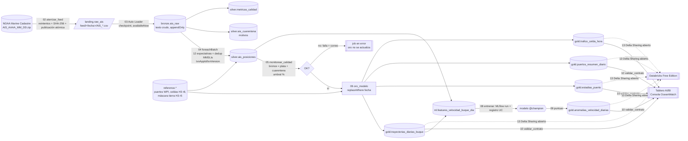

# Arquitectura de la Entrega 2

## Capas y responsabilidades

| Capa | Tablas | Garantía | Cómo se implementa |
|---|---|---|---|
| Landing | Volume `landing.raw_ais` | El archivo está completo antes de ser visible | ZIP verificado; CSV publicado con `os.replace` desde `staging/` |
| Bronce | `bronze.ais_raw` | Crudo e inmutable; cada archivo entra exactamente una vez | Auto Loader + checkpoint; Delta `appendOnly`; columnas como texto |
| Plata | `silver.ais_posiciones`, `silver.ais_cuarentena`, `silver.metricas_calidad` | Solo filas que pasan las compuertas; clave única (MMSI, timestamp); cada fila de bronce termina en plata o en cuarentena | `foreachBatch` idempotente; `quality.py` |
| Oro | 5 tablas del contrato | Modelo de negocio calculado solo desde plata; contrato validado | `gold.py`, `contract.py`, `replaceWhere` por fecha |
| ML | `ml.features_velocidad_buque_dia`, modelo UC | Las mismas variables para entrenar y puntuar | `ml.py`, MLflow |
| Ops | `ops.pipeline_runs`, `ops.feed_calendar`, Volume `ops.checkpoints` | Trazabilidad de cada intento | orquestador / Databricks Jobs |

## Código compartido Databricks ↔ local

| Módulo | Responsabilidad | Diferencia de plataforma |
|---|---|---|
| `lakehouse.py` | Nombres de tablas, rutas, escrituras Delta (`append` con txn, `replaceWhere`) | UC `catalogo.esquema.tabla` frente a ``delta.`ruta` `` |
| `geo.py` | H3 y haversine | `h3_longlatash3string` nativo frente a pandas UDF `h3` |
| `streaming.py` | Bronce y plata | `cloudFiles` frente a la fuente `csv` de archivos |
| `quality.py`, `gold.py`, `ml.py`, `contract.py`, `pipeline.py`, `feed.py`, `setup.py` | Lógica de negocio | Ninguna |

Los notebooks (`notebooks/NN_*.py`) son envoltorios de 5 a 10 líneas que leen los parámetros del job y llaman a la librería. El orquestador local (`scripts/run_pipeline_local.py`) llama las mismas funciones con el mismo DAG.
