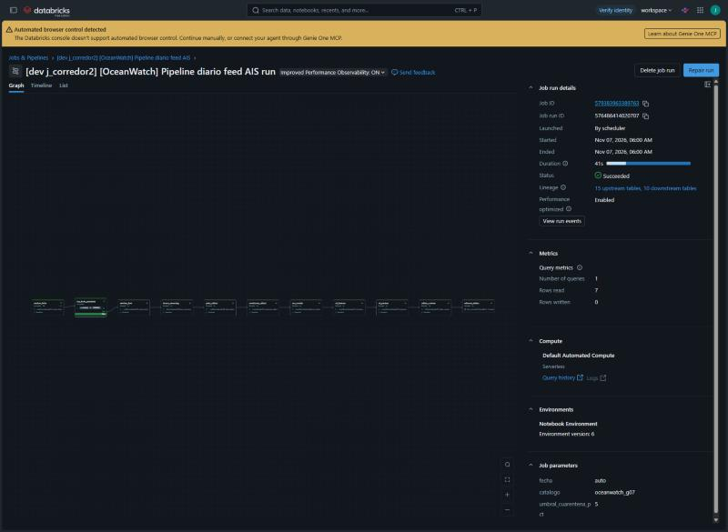
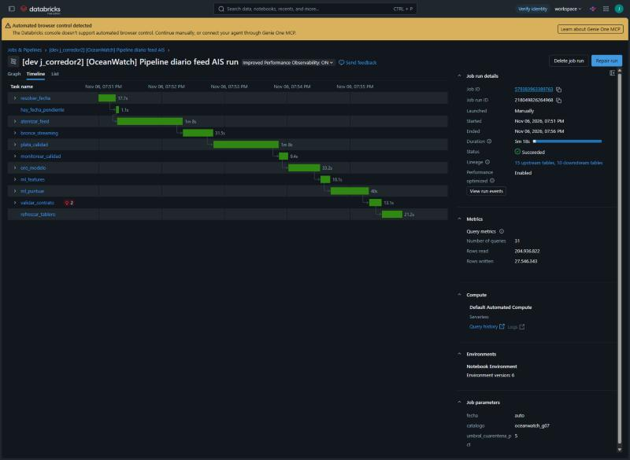

# Evidencia requisito 3 - Orquestación

## Definición del job (Databricks Jobs, Asset Bundle)

`resources/oceanwatch_diario.job.yml` define el job **`[OceanWatch] Pipeline diario feed AIS`**:

```text
resolver_fecha ─► hay_fecha_pendiente (condition: fecha != NINGUNA)
                    └─(true)► aterrizar_feed ─► bronce_streaming ─► plata_calidad ─► monitorear_calidad
                                 ─► oro_modelo ─► ml_features ─► ml_puntuar ─► validar_contrato ─► refrescar_tablero
```

| Propiedad pedida | Cómo se cumple |
|---|---|
| Tareas y dependencias | 11 tareas con `depends_on`; una `condition_task` corta el DAG si no hay días pendientes; `dashboard_task` refresca la consola al final |
| Parámetros (la fecha del día) | Parámetro de job `fecha` (`auto` o `AAAA-MM-DD`); `resolver_fecha` lo publica como *task value* (`{{tasks.resolver_fecha.values.fecha}}`). También se parametrizan `catalogo` y `umbral_cuarentena_pct` |
| Reintentos | `max_retries` y `min_retry_interval_millis` por tarea: 3 en la descarga (red), 2 en streaming y oro (son idempotentes), 0 en monitoreo y contrato (reintentar no corrige una violación de calidad) |
| Monitoreo | `email_notifications.on_failure`, regla `health` de duración > 1 h, `timeout_seconds`, `max_concurrent_runs: 1`; bitácora por tarea en `ops.pipeline_runs`; compuertas `monitorear_calidad` y `validar_contrato` |
| Ejecución programada | `schedule.quartz_cron_expression: "0 0 6 * * ?"`, `America/Bogota`, `UNPAUSED` |

El job `oceanwatch_backfill_historico` (carga del corpus 01-07 jun, excepciones navegables y entrenamiento del modelo) se ejecuta una vez antes del diario.

## Demostración local con el mismo DAG

`scripts/run_pipeline_local.py` ejecuta las mismas tareas, con los mismos nombres, sobre la misma librería. El detalle completo de cada intento está en [`local/resultados_locales.md`](local/resultados_locales.md) (sección 4, tabla `ops.pipeline_runs`). Logs: [`logs/orquestacion_feed_programado.log`](logs/orquestacion_feed_programado.log), [`logs/orquestacion_falla_feed_ausente.log`](logs/orquestacion_falla_feed_ausente.log) y [`logs/reproceso_oro_v2.log`](logs/reproceso_oro_v2.log).

### 1. Ejecución programada con reintentos

Comando: `--fecha auto --programar-cada 20 --max-ejecuciones 3 --inyectar-falla bronce_streaming` (la falla inyectada ocurre en el primer intento de `bronce_streaming` de cada corrida).

| Disparo | run_id | Fecha resuelta | Resultado | Detalle |
|---|---|---|---|---|
| 1 | `20261106T135748-d63d84` | 2023-06-08 | **EXITOSO** | `bronce_streaming` falló en el intento 1 y pasó en el 2 (872,650 filas); 102/102 chequeos de contrato |
| 2 (20 s después) | `20261106T140256-117bc6` | 2023-06-09 | **EXITOSO** | Mismo patrón: intento 2 con 859,555 filas; 102/102 chequeos |
| 3 | `20261106T140649-013565` | 2023-06-10 | Interrumpido | Sin ZIP local, `aterrizar_feed` empezó a descargar de NOAA un día no autorizado para la prueba. Se detuvo y desde entonces la tarea local falla en lugar de descargar |

`fecha=auto` avanzó solo sobre el calendario (`ops.feed_calendar`): primer día FEED sin trayectorias en oro.

### 2. Falla persistente: reintentos agotados y dependientes omitidos

Corrida `20261106T144644-321a7d` (`fecha=auto` → 2023-06-10, sin archivo): `aterrizar_feed` falló en los intentos 1, 2 y 3 con espera exponencial (3 s, 6 s). Las 7 tareas dependientes quedaron `OMITIDO` y el job terminó `FALLIDO`. Oro no se modificó: el contrato de 06-08 y 06-09 sigue intacto.

**Cómo repetirla.** Esta corrida se hizo cuando el ZIP del 10-jun aún no estaba descargado. Ahora `Datos/downloads/` tiene los 14 días, así que la llegada fallida del feed se simula apuntando el orquestador a una carpeta sin ZIP. El camino de código es el mismo (`land_day` lanza `FileNotFoundError` y nunca descarga):

```powershell
.\scripts\docker_run.ps1 python scripts/run_pipeline_local.py --fecha auto --zip-dir /workspace/Datos/feed_ausente --espera-reintento 3
```

Repetición del 2026-11-07, corrida `20261107T023625-29c49e` con los 14 ZIP ya en `Datos/downloads/`: `resolver_fecha` → 2023-06-10; `aterrizar_feed` falló en los intentos 1, 2 y 3 (esperas de 3 s y 6 s); las 7 tareas dependientes quedaron `OMITIDO`; resultado `FALLIDO`, código de salida 1. El comportamiento es idéntico al de la corrida original.

### 3. Idempotencia del reproceso

- **Backfill:** la segunda corrida del backfill 01-jun (`20261106T135415-cf220f`), después de corregir `ml_entrenar`, leyó **0 filas nuevas** en bronce y plata (checkpoints). Oro se reescribió con los mismos conteos: 1,996 trayectorias, 838,048 posiciones.
- **v2:** al cambiar la regla de estadías (D-E2-07 v2), se re-ejecutó el DAG diario con `--fecha` explícita para 01, 08 y 09 de junio. Bronce y plata no cambiaron y oro se reemplazó por fecha con `replaceWhere` ([`logs/reproceso_oro_v2.log`](logs/reproceso_oro_v2.log)).

## En el workspace institucional

- **Feed 08-14 jun:** 7 corridas `fecha=auto`, todas SUCCESS. Bronce = filas del CSV y plata + cuarentena = bronce en cada día ([evidencia 12](12%20evidencia_databricks.md#feed-completo-08-14-jun-verificado-el-2026-11-07)).
- **Ejecución programada:** corrida `576486414020707` con trigger `PERIODIC` (cron 06:00 America/Bogota, 2026-11-07). Sin días pendientes, `hay_fecha_pendiente = false` y las 9 tareas siguientes quedaron `SKIPPED/EXCLUDED` ([evidencia 12](12%20evidencia_databricks.md#ejecución-programada-y-fin-del-feed)).
- **Reintentos:** en el backfill, `bronce_streaming` falló y se reintentó sin duplicar filas (evidencia 12, tabla de reparaciones).
- **Alertas:** `on_failure` y `on_duration_warning_threshold_exceeded` → `j.corredor2@uniandes.edu.co` (desplegado el 2026-11-07).

**Capturas de la UI de Jobs:**

| Corrida programada `576486414020707` (*Launched: By scheduler*, 41 s, `fecha=auto`) | Feed 14-jun `218049826264968`: 11 tareas en orden, SUCCESS en 5 min 18 s |
|---|---|
|  |  |

Pendiente: una corrida fallida en el workspace que muestre reintentos y el correo de alerta. Hoy los reintentos en Databricks solo están documentados en las reparaciones del backfill (evidencia 12).
