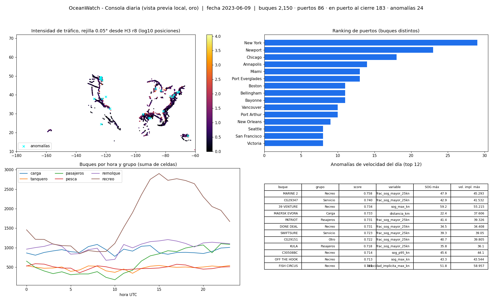
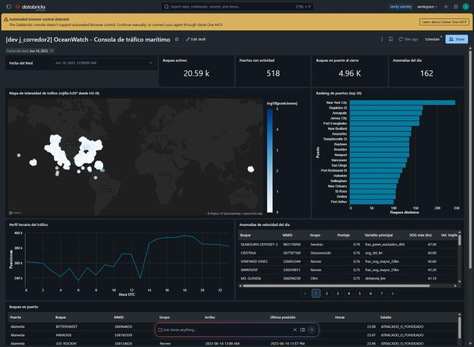

# Evidencia requisito 4 - Consola de visualización

**Herramienta:** Databricks AI/BI Dashboards, la opción recomendada en el enunciado. Definición: [`dashboards/oceanwatch_consola.lvdash.json`](../../dashboards/oceanwatch_consola.lvdash.json), generada por `scripts/generar_tablero.py` a partir de las consultas SQL de [`dashboards/sql/`](../../dashboards/sql/). Se despliega con el bundle (`resources/oceanwatch_consola.dashboard.yml`) y la tarea `refrescar_tablero` del job la refresca después de cada día.

**Alimentado solo por la capa oro:** los seis datasets consultan únicamente `<catálogo>.gold.*`.

| Panel pedido | Widget | Dataset / tabla oro |
|---|---|---|
| Mapa de intensidad de tráfico por celda | Mapa de puntos (`symbol-map`): las celdas H3 r8 de oro se agregan en una rejilla de 0.05° (~5.5 km); color = log10(posiciones) | `02_mapa_intensidad_celda` ← `trafico_celda_hora` |
| Ranking de puertos | Barras top 20 por buques distintos | `04_ranking_puertos` ← `puertos_resumen_diario` |
| Buques en puerto | Tabla de estadías (atracados o en puerto al cierre) y contador | `05_buques_en_puerto` ← `estadias_puerto`; `01_kpis_dia` |
| Anomalías del día | Tabla con puntaje, variable principal y velocidades, más contador | `06_anomalias_dia` ← `anomalias_velocidad_diarias` |
| Contexto | Filtro de fecha, KPIs y perfil horario por grupo de buque | `01_kpis_dia`, `03_trafico_por_hora` |

## Vista previa local (mismas consultas sobre oro local, 2023-06-09)

| KPI | 01-jun | 08-jun | 09-jun |
|---|---:|---:|---:|
| Buques activos | 1,996 | 2,054 | 2,150 |
| Puertos con actividad | 78 | 81 | 86 |
| Buques en puerto al cierre | 168 | 172 | 183 |
| Anomalías del día | 21 | 25 | 24 |

Top 5 del ranking del 09-jun: New York (29 buques), Newport (23), Chicago (18), Annapolis (14), Miami (13). Los resultados de cada consulta están en [`local/tablero/*.csv`](local/tablero/).

> La vista previa PNG se generó con matplotlib solo para verificar en local que las consultas devuelven datos coherentes. **No es el entregable.** El entregable es el tablero AI/BI publicado en el workspace institucional.

## En el workspace institucional (verificado el 2026-11-07)

- **Despliegue:** el bundle publicó el tablero [`OceanWatch - Consola de tráfico marítimo`](https://dbc-18ae9c2d-d518.cloud.databricks.com/dashboardsv3/01f1d9f8b9351847a578d7ab844fbbe7/published) sobre el *Serverless Starter Warehouse* (`4f11fd1da31b2442`). La revisión publicada es la del despliegue del 2026-11-07.
- **Corrección de catálogo:** hasta el 2026-11-06 el `.lvdash.json` consultaba `oceanwatch_g06`, un catálogo inexistente. Se regeneró con `scripts/generar_tablero.py --catalogo oceanwatch_g07` y el tablero se volvió a desplegar. Los 6 datasets publicados consultan ahora `oceanwatch_g07.gold.*`.
- **Widgets publicados (10):** filtro de fecha; 4 contadores (buques, puertos, buques en puerto, anomalías); mapa de intensidad; barras del ranking de puertos; línea del tráfico por hora; tablas de anomalías y de buques en puerto.
- **Consultas ejecutadas en el warehouse:** son las mismas de `dashboards/sql/`, con `__CATALOGO__ = oceanwatch_g07`. Todas cubren los 14 días:

| Dataset | Filas | Días | Rango |
|---|---:|---:|---|
| `01_kpis_dia` | 14 | 14 | 2023-06-01 a 2023-06-14 |
| `02_mapa_intensidad_celda` (antes de la corrección: celdas r8) | 5,679,075 | 14 | 2023-06-01 a 2023-06-14 |
| `03_trafico_por_hora` | 336 | 14 | 2023-06-01 a 2023-06-14 |
| `04_ranking_puertos` | 280 | 14 | 2023-06-01 a 2023-06-14 |
| `05_buques_en_puerto` | 131,102 | 14 | 2023-06-01 a 2023-06-14 |
| `06_anomalias_dia` | 3,098 | 14 | 2023-06-01 a 2023-06-14 |

- **Refresco:** la tarea `refrescar_tablero` del job diario terminó SUCCESS en las 7 corridas del feed 08-14.

### Revisión visual y correcciones (2026-11-07)

Al abrir el tablero publicado aparecieron tres problemas que el JSON no mostraba:

| Problema observado | Causa (probada con un tablero de prueba) | Corrección |
|---|---|---|
| Mapa: "Invalid widget definition is imported." | `point-map` no es un tipo de widget de AI/BI: falla en las specs v1, v2 y v3. `symbol-map` v2 sí se dibuja | `widgetType: symbol-map`, spec v2 |
| Mapa con "Truncated data" | Un día tiene hasta 444,917 celdas H3 r8 y el widget trunca el resultado | `02_mapa_intensidad_celda` agrega los centroides r8 en una rejilla de 0.05°: como máximo 59,560 puntos por día (14-jun), sin truncar. Se conserva el total (14-jun: 8,850,579 posiciones = plata). La rejilla regular la admite el enunciado y el SQL sigue siendo portable a Spark local |
| Tablas de anomalías y de buques en puerto inválidas | La spec v1 de `table` ya no se acepta | Spec v2 |
| Filtro en "All": el ranking sumaba los 14 días (>3,000 buques en New York) y el perfil horario mezclaba días | El filtro no tenía valor por defecto | `defaultSelection` = 2023-06-14 (parámetro `--fecha-defecto` de `generar_tablero.py`) |

Después de volver a desplegar, el tablero publicado abre en 14-jun-2023 y no queda ningún widget inválido. Los contadores coinciden con SQL: 20,591 buques activos (se muestra 20.59 k), 518 puertos con actividad y 162 anomalías.

### Captura del tablero publicado (14-jun-2023)

Se ven los 10 widgets: filtro, 4 contadores (20.59 k buques, 518 puertos, 4.96 K en puerto al cierre, 162 anomalías), mapa de intensidad con escala log10, ranking top 20 (New York City primero), perfil horario de un solo día y las tablas de anomalías y de buques en puerto.

