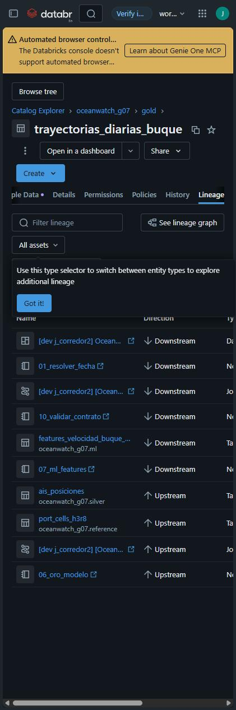
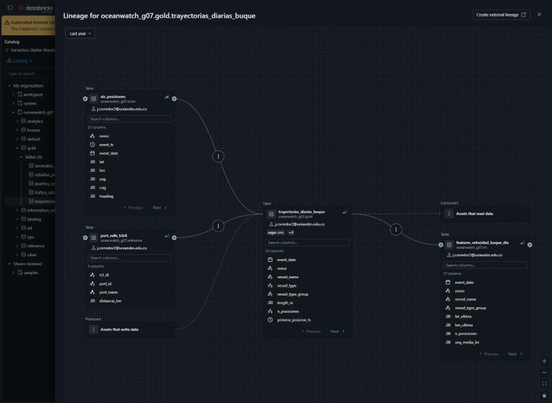

# Evidencia requisito 5 - Gobernanza

## 1. Esquemas con permisos por rol

El catálogo `oceanwatch_g07` separa las capas en esquemas (`setup.SCHEMAS`). El notebook `notebooks/12_gobernanza.py` otorga permisos **por esquema** a cuatro grupos parametrizables:

| Esquema | `oceanwatch_ingenieros` | `oceanwatch_cientificos` | `oceanwatch_analistas` | `oceanwatch_tablero` |
|---|---|---|---|---|
| `landing` (Volume) | ALL PRIVILEGES | - | - | - |
| `bronze` | ALL PRIVILEGES | - | - | - |
| `silver` | ALL PRIVILEGES | USE SCHEMA, SELECT | - | - |
| `gold` | ALL PRIVILEGES | USE SCHEMA, SELECT | USE SCHEMA, SELECT | USE SCHEMA, SELECT |
| `ml` | ALL PRIVILEGES | SELECT, MODIFY, CREATE TABLE, CREATE MODEL, EXECUTE | - | - |
| `reference` | ALL PRIVILEGES | USE SCHEMA, SELECT | USE SCHEMA, SELECT | - |
| `ops` | ALL PRIVILEGES | - | - | - |

- Todos reciben `USE CATALOG`. Ningún permiso se da a nivel de catálogo, porque Unity Catalog es aditivo y no tiene DENY.
- Cada `GRANT` se registra con estado OK/ERROR, y la evidencia la completan `SHOW GRANTS ON SCHEMA`.
- En la Entrega 1 (Free Edition) los `SHOW GRANTS` devolvían cero filas porque había un solo usuario. En el workspace institucional los grupos deben existir en la cuenta, por eso sus nombres son widgets.

## 2. Linaje

- Unity Catalog captura automáticamente el linaje de tablas y columnas de cada escritura del job: `landing → bronze.ais_raw → silver.* → gold.* → ml.* → gold.anomalias_velocidad_diarias`.
- El notebook 12 lo consulta en `system.access.table_lineage` y `system.access.column_lineage`. Se ve gráficamente en *Catalog Explorer → Lineage*.
- Linaje declarado en el código:
  - Cada fila de plata y de cuarentena conserva `_source_file`, `_bronze_ingested_at` y `_silver_batch_id`.
  - Cada fila de oro lleva `_gold_processed_at`.
  - Cada anomalía lleva `modelo` y `modelo_version`.
  - Cada intento del job queda en `ops.pipeline_runs`.
- **Verificación automática:** `validar_contrato` comprueba que oro solo tenga buques presentes en plata y que ninguna clave en cuarentena aparezca en plata. Resultado local: 0 violaciones en 01, 08 y 09 de junio.

## 3. Contrato de datos de oro

- Fuente: [`contracts/gold_contract.yml`](../../contracts/gold_contract.yml). Documento legible: [`docs/contrato_datos_oro.md`](../contrato_datos_oro.md).
- **Se hace cumplir, no solo se documenta:**
  1. el DDL de oro se genera del contrato, con comentarios de columna y la propiedad `oceanwatch.contrato.version = 1.0.0`;
  2. `conform()` aplica el esquema exacto en cada escritura;
  3. `validar_contrato` revisa por fecha esquema, nulos, rangos, dominios y clave primaria. Local: **102/102 chequeos OK** en cada fecha;
  4. el notebook 12 agrega etiquetas UC (`capa`, `contrato`, `contrato_version`, `propietario`, `clasificacion`) consultables en `information_schema.table_tags`.
- Prueba unitaria `test_ddl_de_oro_generado_desde_contrato`: la tabla creada tiene la partición y la versión del contrato.

## 4. Ejecución en el workspace institucional (2026-11-07)

### Principals por rol

El workspace no tenía grupos de OceanWatch. Solo existían `admins` y `users`, más un clon de `users`, todos con un único miembro. El usuario del equipo es administrador del **workspace**, no de la **cuenta**: la API de cuenta responde `unauthenticated`. Se probó crear un grupo desde el workspace y quedó como `WorkspaceGroup`; Unity Catalog lo rechazó con `PRINCIPAL_DOES_NOT_EXIST` y se borró.

**Solución adoptada:** un *service principal* por rol, que un administrador del workspace sí puede crear y que Unity Catalog sí acepta. En producción serían grupos de cuenta con personas como miembros; el notebook no cambia, porque los principals son widgets.

| Rol | Service principal | `applicationId` |
|---|---|---|
| Ingeniería | `sp-oceanwatch-ingenieros` | `2fb37799-278f-41f6-9145-6544f6fc8839` |
| Ciencia de datos | `sp-oceanwatch-cientificos` | `6cd416b4-0022-405f-8b14-119c10ec50ce` |
| Analítica | `sp-oceanwatch-analistas` | `62ac7537-50d8-4a91-af00-f50bffb7350e` |
| Tablero | `sp-oceanwatch-tablero` | `2f30b2d4-6866-44e4-b44e-59ac252956ca` |

Ejecución: corrida única serverless [`159612244398872`](https://dbc-18ae9c2d-d518.cloud.databricks.com/?o=7474654323473441#job/1091447617025635/run/159612244398872) de `notebooks/12_gobernanza`, **SUCCESS**.

### Permisos efectivos (`information_schema.schema_privileges`)

| Rol | landing | bronze | silver | gold | ml | reference | ops |
|---|---|---|---|---|---|---|---|
| sp-ingenieros | ALL | ALL | ALL | ALL | ALL | ALL | ALL |
| sp-cientificos | - | - | USE SCHEMA, SELECT | USE SCHEMA, SELECT | USE SCHEMA, SELECT, MODIFY, CREATE TABLE, CREATE MODEL, EXECUTE | USE SCHEMA, SELECT | - |
| sp-analistas | - | - | - | USE SCHEMA, SELECT | - | USE SCHEMA, SELECT | - |
| sp-tablero | - | - | - | USE SCHEMA, SELECT | - | - | - |

Coincide celda por celda con el diseño de la sección 1.

> **Hallazgo:** `account users` tiene `ALL PRIVILEGES`, `MANAGE`, `EXTERNAL USE SCHEMA` y `READ METADATA` sobre **todo el catálogo**; los esquemas los heredan. El grant no lo hizo el pipeline. Mientras exista, cualquier usuario de la cuenta tiene control total y los permisos por rol no restringen nada. Ver la decisión pendiente en el plan de cierre.

### Contrato como metadatos

- Las 5 tablas oro tienen `capa=oro`, `contrato=oceanwatch-gold`, `contrato_version=1.0.0`, `clasificacion=uso_interno` y `propietario=<applicationId de ingeniería>` (`information_schema.table_tags`).
- Comentarios: 93/93 columnas de oro tienen comentario (anomalías 18/18, estadías 17/17, puertos 18/18, tráfico 17/17, trayectorias 23/23).

### Linaje capturado por Unity Catalog (`system.access.table_lineage`)

| Origen | Destino |
|---|---|
| `silver.ais_posiciones`, `reference.port_cells_h3r8` | `gold.trayectorias_diarias_buque`, `gold.estadias_puerto` |
| `silver.ais_posiciones` | `gold.trafico_celda_hora` |
| `gold.estadias_puerto`, `reference.ports` | `gold.puertos_resumen_diario` |
| `gold.trayectorias_diarias_buque`, `silver.ais_posiciones` | `ml.features_velocidad_buque_dia` |
| `bronze.ais_raw`, `reference.land_cells_h3r5` | `reference.waterway_cells_h3r5` |
| `silver.ais_posiciones` | `silver.ais_cuarentena`, `silver.metricas_calidad` |

Cada arista de oro y de features tiene 14 eventos, uno por día procesado.

**Huecos observados (limitación declarada):**
- `bronze.ais_raw → silver.*` no aparece: plata se escribe desde `foreachBatch` de Structured Streaming. Lo cubren `_source_file`, `_bronze_ingested_at` y `_silver_batch_id` en cada fila.
- `ml.features_velocidad_buque_dia → gold.anomalias_velocidad_diarias` no aparece: la puntuación pasa por pandas con el modelo de MLflow. Lo cubren las columnas `modelo` y `modelo_version`.

### Linaje en Catalog Explorer

La pestaña *Lineage* de `gold.trayectorias_diarias_buque` muestra:
- **Hacia arriba:** `silver.ais_posiciones`, `reference.port_cells_h3r8`, el job y el notebook `06_oro_modelo`.
- **Hacia abajo:** `ml.features_velocidad_buque_dia`, el tablero publicado y los notebooks `07_ml_features` y `10_validar_contrato`.

UC enlaza las tablas con el job, los notebooks y el tablero que las usan.



Grafo de linaje (*See lineage graph*): `silver.ais_posiciones` y `reference.port_cells_h3r8` → `gold.trayectorias_diarias_buque` (con la etiqueta `capa: oro`) → `ml.features_velocidad_buque_dia`, a nivel de columna.




**Decisión del equipo (2026-11-07):** el grant de `account users` se mantiene, como riesgo aceptado. El catálogo vive en un workspace académico compartido y los integrantes entran a él por ese grant. Revocarlo les quitaría el acceso mientras no existan grupos de cuenta. Por eso los permisos por rol quedan **definidos y verificados**, pero **no son restrictivos** mientras el grant siga vigente. En un entorno productivo, el primer paso sería:

```sql
REVOKE ALL PRIVILEGES, MANAGE, EXTERNAL USE SCHEMA ON CATALOG oceanwatch_g07 FROM `account users`;
```
