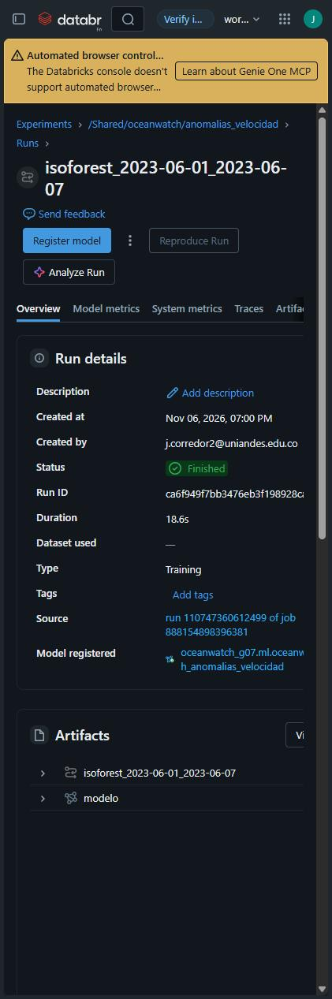
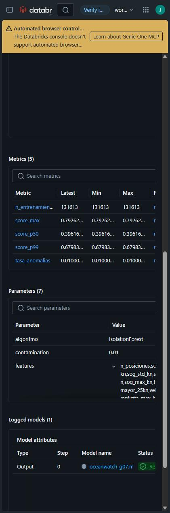
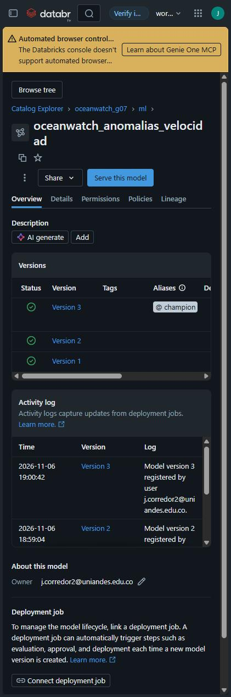

# Evidencia requisito 6 - ML con MLflow (anomalías de velocidad)

**Caso elegido:** detección de anomalías de velocidad por buque y día (D-E2-08). Alimenta directamente el panel "anomalías del día" del tablero. El objetivo es la **integración reproducible** dentro del pipeline, no la precisión.

## Integración en el pipeline

| Paso | Dónde | Tarea del job |
|---|---|---|
| Extracción de variables desde el lakehouse | `ml.build_features`: plata (estadísticas de SOG) + oro (trayectorias D-04) → `ml.features_velocidad_buque_dia` | `ml_features` (diario y backfill) |
| Entrenamiento + experimento trackeado | `ml.train`: `Pipeline(SimpleImputer → StandardScaler → IsolationForest)`; MLflow registra parámetros, métricas, artefactos (`top25_anomalias_entrenamiento.csv`, `estadisticas_features.json`), firma y ejemplo de entrada | `ml_entrenar` (job de backfill) |
| Registro del modelo | `registered_model_name` = `<catálogo>.ml.oceanwatch_anomalias_velocidad` (Unity Catalog, `databricks-uc`); alias `champion` | `ml_entrenar` |
| Inferencia por lotes | `ml.score` carga `models:/…@champion` y escribe `gold.anomalias_velocidad_diarias` (`replaceWhere` por fecha) | `ml_puntuar` (diario) |
| Validación | La tabla de anomalías es parte del contrato de oro | `validar_contrato` |

Entrenamiento y puntuación usan la **misma función de variables**, así que no hay desalineación training/serving. Promover un nuevo modelo solo exige mover el alias `champion`, sin cambiar código.

## Variables (por buque y día)

`n_posiciones`, `sog_media_kn`, `sog_std_kn`, `sog_p95_kn`, `sog_max_kn`, `frac_sog_mayor_25kn`, `velocidad_implicita_max_kn` (D-04), `distancia_km` (D-04), `frac_pares_excluidos_d04`, `length_m`.

## Resultado local

| Elemento | Valor |
|---|---|
| Backend MLflow local | SQLite `local_lakehouse/_mlflow/mlflow.db` (tracking + registry), equivalente local de UC |
| Run de entrenamiento | `4193157ee6c9498d9efd83dcec16df01`, experimento `oceanwatch_anomalias_velocidad` |
| Parámetros | IsolationForest, `contamination = 0.01`, `n_estimators = 200`, `random_state = 42`, entrenamiento 2023-06-01, buques con ≥ 10 posiciones |
| Métricas | `n_entrenamiento = 1857`, `tasa_anomalias = 0.0102`, `score_p50 = 0.3954`, `score_p99 = 0.6835`, `score_max = 0.7496` |
| Modelo registrado | `oceanwatch_anomalias_velocidad` **v1**, alias `champion` |
| Puntuación diaria | 01-jun: 21 anomalías / 1,996 buques · 08-jun: 25 / 2,054 · 09-jun: 24 / 2,150 |

**Lectura de los resultados.** La mayoría de anomalías son embarcaciones de recreo, servicio (p. ej. Guardia Costera `CG29347`) y pasajeros rápidos. Tienen una fracción alta de posiciones a más de 25 kn y velocidades implícitas de 35–59 kn, coherentes con su SOG. El modelo marca patrones de velocidad *inusuales para la flota*, que no siempre son errores. `motivo_principal` explica la variable que más se desvía.

**Primer intento fallido (registrado en `ops.pipeline_runs`).** MLflow 3.18 serializa scikit-learn con `skops` y rechazó los tipos `numpy.dtype` y `sklearn.tree._tree.Tree`. Se declararon explícitamente como `skops_trusted_types` y el reproceso funcionó.

## En el workspace institucional (verificado el 2026-11-07)

El job de backfill (`888154898396381`) entrenó el modelo con los **7 días históricos completos**. Datos leídos de la API de MLflow y de Unity Catalog:

| Elemento | Valor |
|---|---|
| Experimento | `/Shared/oceanwatch/anomalias_velocidad` (id `4196079514500715`) |
| Run vigente | `ca6f949f7bb3476eb3f198928ca5ef0c` (`isoforest_2023-06-01_2023-06-07`), FINISHED, 18.6 s; origen: run `110747360612499` del job de backfill |
| Parámetros | IsolationForest, `contamination = 0.01`, `n_estimators = 200`, `random_state = 42`, `min_posiciones = 10`, 10 variables, fechas 01-07 jun |
| Métricas | `n_entrenamiento = 131,613` buque-día; `tasa_anomalias = 0.0100`; `score_p50 = 0.3962`; `score_p99 = 0.6798`; `score_max = 0.7926` |
| Modelo en Unity Catalog | `oceanwatch_g07.ml.oceanwatch_anomalias_velocidad`: versiones 1, 2 y 3 en estado READY; **alias `champion` → v3** |
| Puntuación | `gold.anomalias_velocidad_diarias`: 14 días (01-14 jun), 287,145 buque-día, **3,098 anomalías**, todas con `modelo_version = 3` |

**Versiones 1 y 2.** Corresponden a los runs `9050a911…` y `6655086b…`, que quedaron FAILED después de registrar el modelo, en los intentos fallidos de `ml_entrenar` durante el backfill (reparaciones descritas en la evidencia 12). Las métricas son idénticas a las de v3 porque el entrenamiento es determinista (`random_state = 42`). El alias se movió a v3 y la puntuación del feed solo usa v3, sin cambiar código, como prevé D-E2-08.

**Capturas:**

| Run de entrenamiento | Métricas y parámetros | Modelo en UC con `@champion` |
|---|---|---|
|  |  |  |
