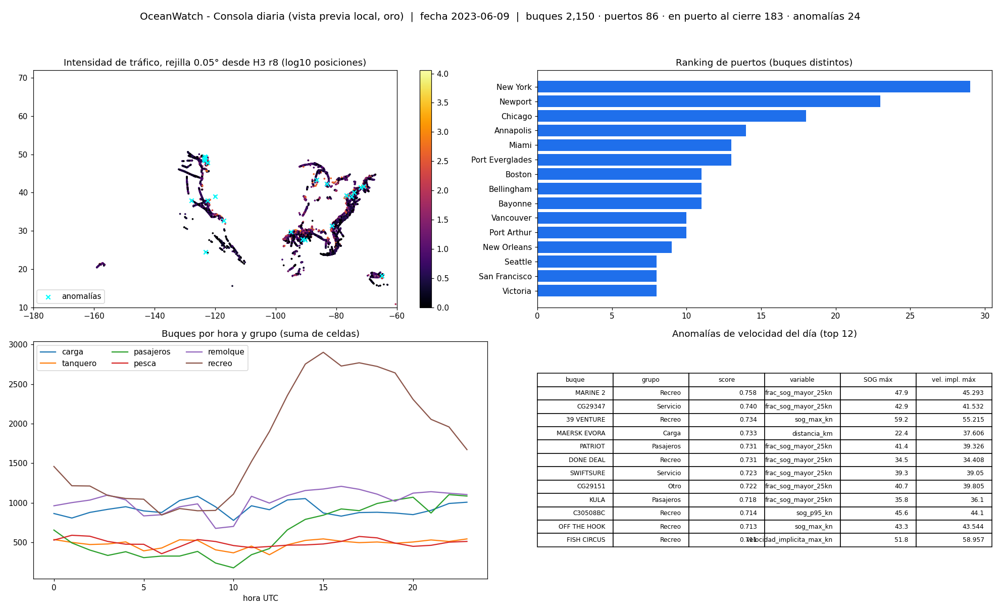

# Resultados de la prueba local (generado por `scripts/evidencias_locales.py`)

Muestra por buque `crc32(MMSI) % 10 == 0` (~10 % de los buques, trayectorias completas) más todos los MMSI no conformes. Días: 2023-06-01 (histórico) y 2023-06-08, 2023-06-09 (feed).

## 1. Filas por capa y fecha

| tabla | 2023-06-01 | 2023-06-08 | 2023-06-09 |
|---|---|---|---|
| bronze.ais_raw | 846,338 | 872,650 | 859,555 |
| gold.anomalias_velocidad_diarias | 1,996 | 2,054 | 2,150 |
| gold.estadias_puerto | 503 | 532 | 586 |
| gold.puertos_resumen_diario | 78 | 81 | 86 |
| gold.trafico_celda_hora | 114,493 | 123,300 | 127,873 |
| gold.trayectorias_diarias_buque | 1,996 | 2,054 | 2,150 |
| ml.features_velocidad_buque_dia | 1,996 | 2,054 | 2,150 |
| silver.ais_cuarentena | 8,290 | 8,222 | 8,435 |
| silver.ais_posiciones | 838,048 | 864,428 | 851,120 |

## 2. Métricas de calidad por regla (`silver.metricas_calidad`)

| ingestion_date | regla | severidad | evaluados | fallidos | pct |
|---|---|---|---|---|---|
| 2023-06-01 | D01_DUPLICADO_EXACTO | DEDUPLICACION | 838,061 | 13 | 0.0016 |
| 2023-06-01 | D02_DUPLICADO_CONFLICTIVO | DEDUPLICACION | 838,061 | 0 | 0 |
| 2023-06-01 | E01_MMSI_FORMATO | CUARENTENA | 846,338 | 6,911 | 0.8166 |
| 2023-06-01 | E02_TIMESTAMP_VALIDO | CUARENTENA | 846,338 | 0 | 0 |
| 2023-06-01 | E03_TIMESTAMP_EN_VENTANA | CUARENTENA | 846,338 | 0 | 0 |
| 2023-06-01 | E04_COORDENADAS_PRESENTES | CUARENTENA | 846,338 | 0 | 0 |
| 2023-06-01 | E05_COORDENADAS_EN_RANGO | CUARENTENA | 846,338 | 0 | 0 |
| 2023-06-01 | E06_COORDENADAS_EN_AGUA | CUARENTENA | 846,338 | 1,360 | 0.1607 |
| 2023-06-01 | E07_SOG_PLAUSIBLE | CUARENTENA | 846,338 | 11 | 0.0013 |
| 2023-06-01 | E08_COG_RANGO | ADVERTENCIA | 846,338 | 0 | 0 |
| 2023-06-01 | E09_HEADING_RANGO | ADVERTENCIA | 846,338 | 0 | 0 |
| 2023-06-01 | E10_IMO_FORMATO | ADVERTENCIA | 846,338 | 8,094 | 0.9564 |
| 2023-06-01 | E11_VESSELTYPE_CATALOGO | ADVERTENCIA | 846,338 | 1,608 | 0.19 |
| 2023-06-01 | E12_DIMENSIONES_PLAUSIBLES | ADVERTENCIA | 846,338 | 28,089 | 3.3189 |
| 2023-06-01 | RESUMEN_CUARENTENA_COMPUERTAS | RESUMEN | 846,338 | 8,277 | 0.978 |
| 2023-06-08 | D01_DUPLICADO_EXACTO | DEDUPLICACION | 864,444 | 12 | 0.0014 |
| 2023-06-08 | D02_DUPLICADO_CONFLICTIVO | DEDUPLICACION | 864,444 | 4 | 0.0005 |
| 2023-06-08 | E01_MMSI_FORMATO | CUARENTENA | 872,650 | 6,362 | 0.729 |
| 2023-06-08 | E02_TIMESTAMP_VALIDO | CUARENTENA | 872,650 | 0 | 0 |
| 2023-06-08 | E03_TIMESTAMP_EN_VENTANA | CUARENTENA | 872,650 | 0 | 0 |
| 2023-06-08 | E04_COORDENADAS_PRESENTES | CUARENTENA | 872,650 | 0 | 0 |
| 2023-06-08 | E05_COORDENADAS_EN_RANGO | CUARENTENA | 872,650 | 0 | 0 |
| 2023-06-08 | E06_COORDENADAS_EN_AGUA | CUARENTENA | 872,650 | 1,843 | 0.2112 |
| 2023-06-08 | E07_SOG_PLAUSIBLE | CUARENTENA | 872,650 | 4 | 0.0005 |
| 2023-06-08 | E08_COG_RANGO | ADVERTENCIA | 872,650 | 0 | 0 |
| 2023-06-08 | E09_HEADING_RANGO | ADVERTENCIA | 872,650 | 2 | 0.0002 |
| 2023-06-08 | E10_IMO_FORMATO | ADVERTENCIA | 872,650 | 6,034 | 0.6915 |
| 2023-06-08 | E11_VESSELTYPE_CATALOGO | ADVERTENCIA | 872,650 | 339 | 0.0388 |
| 2023-06-08 | E12_DIMENSIONES_PLAUSIBLES | ADVERTENCIA | 872,650 | 30,192 | 3.4598 |
| 2023-06-08 | RESUMEN_CUARENTENA_COMPUERTAS | RESUMEN | 872,650 | 8,206 | 0.9404 |
| 2023-06-09 | D01_DUPLICADO_EXACTO | DEDUPLICACION | 851,149 | 20 | 0.0023 |
| 2023-06-09 | D02_DUPLICADO_CONFLICTIVO | DEDUPLICACION | 851,149 | 9 | 0.0011 |
| 2023-06-09 | E01_MMSI_FORMATO | CUARENTENA | 859,555 | 7,249 | 0.8433 |
| 2023-06-09 | E02_TIMESTAMP_VALIDO | CUARENTENA | 859,555 | 0 | 0 |
| 2023-06-09 | E03_TIMESTAMP_EN_VENTANA | CUARENTENA | 859,555 | 0 | 0 |
| 2023-06-09 | E04_COORDENADAS_PRESENTES | CUARENTENA | 859,555 | 0 | 0 |
| 2023-06-09 | E05_COORDENADAS_EN_RANGO | CUARENTENA | 859,555 | 0 | 0 |
| 2023-06-09 | E06_COORDENADAS_EN_AGUA | CUARENTENA | 859,555 | 1,147 | 0.1334 |
| 2023-06-09 | E07_SOG_PLAUSIBLE | CUARENTENA | 859,555 | 14 | 0.0016 |
| 2023-06-09 | E08_COG_RANGO | ADVERTENCIA | 859,555 | 0 | 0 |
| 2023-06-09 | E09_HEADING_RANGO | ADVERTENCIA | 859,555 | 0 | 0 |
| 2023-06-09 | E10_IMO_FORMATO | ADVERTENCIA | 859,555 | 5,263 | 0.6123 |
| 2023-06-09 | E11_VESSELTYPE_CATALOGO | ADVERTENCIA | 859,555 | 1,064 | 0.1238 |
| 2023-06-09 | E12_DIMENSIONES_PLAUSIBLES | ADVERTENCIA | 859,555 | 34,768 | 4.0449 |
| 2023-06-09 | RESUMEN_CUARENTENA_COMPUERTAS | RESUMEN | 859,555 | 8,406 | 0.9779 |

## 3. Cuarentena por motivo principal

| ingestion_date | motivo_principal | count |
|---|---|---|
| 2023-06-01 | E01_MMSI_FORMATO | 6,911 |
| 2023-06-01 | E06_COORDENADAS_EN_AGUA | 1,360 |
| 2023-06-01 | D01_DUPLICADO_EXACTO | 13 |
| 2023-06-01 | E07_SOG_PLAUSIBLE | 6 |
| 2023-06-08 | E01_MMSI_FORMATO | 6,362 |
| 2023-06-08 | E06_COORDENADAS_EN_AGUA | 1,841 |
| 2023-06-08 | D01_DUPLICADO_EXACTO | 12 |
| 2023-06-08 | D02_DUPLICADO_CONFLICTIVO | 4 |
| 2023-06-08 | E07_SOG_PLAUSIBLE | 3 |
| 2023-06-09 | E01_MMSI_FORMATO | 7,249 |
| 2023-06-09 | E06_COORDENADAS_EN_AGUA | 1,146 |
| 2023-06-09 | D01_DUPLICADO_EXACTO | 20 |
| 2023-06-09 | E07_SOG_PLAUSIBLE | 11 |
| 2023-06-09 | D02_DUPLICADO_CONFLICTIVO | 9 |

### Compuerta E06 (en el agua): buques afectados

| MMSI | VesselName | VesselType | posiciones | lat_media | lon_media | sog_max |
|---|---|---|---|---|---|---|
| 368158760 | REDDING C | 95 | 1,372 | 29.908 | -91.225 | 6.5 |
| 367798350 | LUCAS PAUL DEVALL | 31 | 1,310 | 28.66 | -96.96 | 4.1 |
| 368238290 | A.B. CENAC | 0 | 1,048 | 30.488 | -91.752 | 2.4 |
| 368193830 | ROCK HALL | 52 | 163 | 38.352 | -75.627 | 6 |
| 367164240 | ELEANOR F MORAN | 31 | 158 | 30.074 | -94.064 | 8.3 |
| 368221490 | ANDREW WALSH | 52 | 84 | 29.941 | -91.25 | 4.8 |
| 367638080 | MARY KAY ECKSTEIN | 31 | 65 | 40.051 | -89.818 | 0 |
| 367614710 | NEPIDAE | 37 | 43 | 36.592 | -76.379 | 6 |
| 368248960 | ANNA ROSE | 57 | 38 | 30.075 | -94.064 | 7.6 |
| 366997750 | FATHER SEELOS | 31 | 15 | 29.907 | -91.221 | 3.6 |
| 235055547 | INFINITE DREAM | 36 | 14 | 36.577 | -76.383 | 6 |
| 338231624 | STEELROD | 37 | 8 | 34.603 | -118.018 | 102.2 |
| 367599990 | NANEA | 37 | 7 | 44.471 | -118.393 | 64.3 |
| 367725310 | MY ANGEL | 30 | 6 | 30.759 | -88.609 | 49.3 |
| 367695220 | STRAVAIGIN A' DORNE | 37 | 5 | 47.691 | -122.031 | 1.4 |

### Excepciones navegables (`reference.waterway_cells_h3r5`)

| h3_r5 | buques_distintos | posiciones | criterio |
|---|---|---|---|
| 85444693fffffff | 5 | 647 | >= 2 MMSI distintos en 2023-06-01..2023-06-01 |
| 85446eabfffffff | 2 | 156 | >= 2 MMSI distintos en 2023-06-01..2023-06-01 |

## 4. Bitácora de ejecuciones (`ops.pipeline_runs`)

| run_id | fecha | tarea | intento | estado | seg | detalle |
|---|---|---|---|---|---|---|
| 20261106T135023-2c1903 | 2023-06-01 | aterrizar_historico | 1 | EXITOSO | 55.2 | {"2023-06-01": {"fecha": "2023-06-01", "zip": "AIS_2023_06_01.zip", "zip_bytes": 343949892, "zip_sha256": "e62 |
| 20261106T135023-2c1903 | 2023-06-01 | bronce_streaming | 1 | EXITOSO | 12.3 | {"query": "bronze_ais_raw", "lotes_con_datos": 1, "filas_entrada": 846338, "ids_lote": [0]} |
| 20261106T135023-2c1903 | 2023-06-01 | excepciones_navegables | 1 | EXITOSO | 16.1 | {"celdas_tierra_con_trafico": 11, "celdas_reclasificadas": 2, "posiciones_en_tierra": 2163, "posiciones_reclas |
| 20261106T135023-2c1903 | 2023-06-01 | plata_calidad | 1 | EXITOSO | 37.8 | {"query": "silver_ais_posiciones", "lotes_con_datos": 1, "filas_entrada": 846338, "ids_lote": [0]} |
| 20261106T135023-2c1903 | 2023-06-01 | monitorear_calidad | 1 | EXITOSO | 5.3 | {"2023-06-01": {"fecha": "2023-06-01", "filas_bronce": 846338, "filas_plata": 838048, "filas_cuarentena": 8290 |
| 20261106T135023-2c1903 | 2023-06-01 | oro_modelo | 1 | EXITOSO | 34.8 | {"2023-06-01": {"trayectorias_diarias_buque": 1996, "estadias_puerto": 783, "trafico_celda_hora": 114493, "pue |
| 20261106T135023-2c1903 | 2023-06-01 | ml_features | 1 | EXITOSO | 5.9 | {"2023-06-01": {"filas": 1996}} |
| 20261106T135023-2c1903 | 2023-06-01 | ml_entrenar | 1 | FALLIDO | 14.1 | {"error": "The saved sklearn model references untrusted types. If you are sure loading these types is safe, se |
| 20261106T135023-2c1903 | 2023-06-01 | ml_puntuar | 0 | OMITIDO | 0 | {"motivo": "dependencia fallida"} |
| 20261106T135023-2c1903 | 2023-06-01 | validar_contrato | 0 | OMITIDO | 0 | {"motivo": "dependencia fallida"} |
| 20261106T135415-cf220f | 2023-06-01 | aterrizar_historico | 1 | EXITOSO | 53.8 | {"2023-06-01": {"fecha": "2023-06-01", "zip": "AIS_2023_06_01.zip", "zip_bytes": 343949892, "zip_sha256": "e62 |
| 20261106T135415-cf220f | 2023-06-01 | bronce_streaming | 1 | EXITOSO | 1.6 | {"query": "bronze_ais_raw", "lotes_con_datos": 0, "filas_entrada": 0, "ids_lote": []} |
| 20261106T135415-cf220f | 2023-06-01 | excepciones_navegables | 1 | EXITOSO | 21.3 | {"celdas_tierra_con_trafico": 11, "celdas_reclasificadas": 2, "posiciones_en_tierra": 2163, "posiciones_reclas |
| 20261106T135415-cf220f | 2023-06-01 | plata_calidad | 1 | EXITOSO | 3.4 | {"query": "silver_ais_posiciones", "lotes_con_datos": 0, "filas_entrada": 0, "ids_lote": []} |
| 20261106T135415-cf220f | 2023-06-01 | monitorear_calidad | 1 | EXITOSO | 6.3 | {"2023-06-01": {"fecha": "2023-06-01", "filas_bronce": 846338, "filas_plata": 838048, "filas_cuarentena": 8290 |
| 20261106T135415-cf220f | 2023-06-01 | oro_modelo | 1 | EXITOSO | 34.9 | {"2023-06-01": {"trayectorias_diarias_buque": 1996, "estadias_puerto": 783, "trafico_celda_hora": 114493, "pue |
| 20261106T135415-cf220f | 2023-06-01 | ml_features | 1 | EXITOSO | 5.8 | {"2023-06-01": {"filas": 1996}} |
| 20261106T135415-cf220f | 2023-06-01 | ml_entrenar | 1 | EXITOSO | 11.4 | {"run_id": "4193157ee6c9498d9efd83dcec16df01", "modelo": "oceanwatch_anomalias_velocidad", "version": "1", "n_ |
| 20261106T135415-cf220f | 2023-06-01 | ml_puntuar | 1 | EXITOSO | 3.2 | {"2023-06-01": {"modelo": "oceanwatch_anomalias_velocidad", "version": "1", "buques_puntuados": 1996, "anomali |
| 20261106T135415-cf220f | 2023-06-01 | validar_contrato | 1 | EXITOSO | 12.8 | {"2023-06-01": {"fecha": "2023-06-01", "chequeos": 102, "fallidos": 0, "detalle_fallidos": []}} |
| 20261106T135748-d63d84 | 2023-06-08 | resolver_fecha | 1 | EXITOSO | 15.1 | {"fecha": "2023-06-08"} |
| 20261106T135748-d63d84 | 2023-06-08 | aterrizar_feed | 1 | EXITOSO | 67.9 | {"fecha": "2023-06-08", "zip": "AIS_2023_06_08.zip", "zip_bytes": 348931376, "zip_sha256": "72b7a149cb50de4d2e |
| 20261106T135748-d63d84 | 2023-06-08 | bronce_streaming | 1 | FALLIDO | 0 | {"error": "Falla transitoria inyectada en bronce_streaming (intento 1)", "traza": "Traceback (most recent call |
| 20261106T135748-d63d84 | 2023-06-08 | bronce_streaming | 2 | EXITOSO | 17.5 | {"query": "bronze_ais_raw", "lotes_con_datos": 1, "filas_entrada": 872650, "ids_lote": [1]} |
| 20261106T135748-d63d84 | 2023-06-08 | plata_calidad | 1 | EXITOSO | 68.5 | {"query": "silver_ais_posiciones", "lotes_con_datos": 1, "filas_entrada": 872650, "ids_lote": [1]} |
| 20261106T135748-d63d84 | 2023-06-08 | monitorear_calidad | 1 | EXITOSO | 7.3 | {"fecha": "2023-06-08", "filas_bronce": 872650, "filas_plata": 864428, "filas_cuarentena": 8222, "cuarentena_c |
| 20261106T135748-d63d84 | 2023-06-08 | oro_modelo | 1 | EXITOSO | 46.8 | {"trayectorias_diarias_buque": 2054, "estadias_puerto": 821, "trafico_celda_hora": 123300, "puertos_resumen_di |
| 20261106T135748-d63d84 | 2023-06-08 | ml_features | 1 | EXITOSO | 8.2 | {"filas": 2054} |
| 20261106T135748-d63d84 | 2023-06-08 | ml_puntuar | 1 | EXITOSO | 9 | {"modelo": "oceanwatch_anomalias_velocidad", "version": "1", "buques_puntuados": 2054, "anomalias": 25} |
| 20261106T135748-d63d84 | 2023-06-08 | validar_contrato | 1 | EXITOSO | 12.1 | {"fecha": "2023-06-08", "chequeos": 102, "fallidos": 0, "detalle_fallidos": []} |
| 20261106T140256-117bc6 | 2023-06-09 | resolver_fecha | 1 | EXITOSO | 1.6 | {"fecha": "2023-06-09"} |
| 20261106T140256-117bc6 | 2023-06-09 | aterrizar_feed | 1 | EXITOSO | 66 | {"fecha": "2023-06-09", "zip": "AIS_2023_06_09.zip", "zip_bytes": 343405316, "zip_sha256": "b885617efa7c02f6ac |
| 20261106T140256-117bc6 | 2023-06-09 | bronce_streaming | 1 | FALLIDO | 0 | {"error": "Falla transitoria inyectada en bronce_streaming (intento 1)", "traza": "Traceback (most recent call |
| 20261106T140256-117bc6 | 2023-06-09 | bronce_streaming | 2 | EXITOSO | 9.4 | {"query": "bronze_ais_raw", "lotes_con_datos": 1, "filas_entrada": 859555, "ids_lote": [2]} |
| 20261106T140256-117bc6 | 2023-06-09 | plata_calidad | 1 | EXITOSO | 41.4 | {"query": "silver_ais_posiciones", "lotes_con_datos": 1, "filas_entrada": 859555, "ids_lote": [2]} |
| 20261106T140256-117bc6 | 2023-06-09 | monitorear_calidad | 1 | EXITOSO | 7 | {"fecha": "2023-06-09", "filas_bronce": 859555, "filas_plata": 851120, "filas_cuarentena": 8435, "cuarentena_c |
| 20261106T140256-117bc6 | 2023-06-09 | oro_modelo | 1 | EXITOSO | 32.5 | {"trayectorias_diarias_buque": 2150, "estadias_puerto": 933, "trafico_celda_hora": 127873, "puertos_resumen_di |
| 20261106T140256-117bc6 | 2023-06-09 | ml_features | 1 | EXITOSO | 6.3 | {"filas": 2150} |
| 20261106T140256-117bc6 | 2023-06-09 | ml_puntuar | 1 | EXITOSO | 3 | {"modelo": "oceanwatch_anomalias_velocidad", "version": "1", "buques_puntuados": 2150, "anomalias": 24} |
| 20261106T140256-117bc6 | 2023-06-09 | validar_contrato | 1 | EXITOSO | 12.8 | {"fecha": "2023-06-09", "chequeos": 102, "fallidos": 0, "detalle_fallidos": []} |
| 20261106T140649-013565 | 2023-06-10 | resolver_fecha | 1 | EXITOSO | 1.6 | {"fecha": "2023-06-10"} |
| 20261106T144644-321a7d | 2023-06-10 | resolver_fecha | 1 | EXITOSO | 15.8 | {"fecha": "2023-06-10"} |
| 20261106T144644-321a7d | 2023-06-10 | aterrizar_feed | 1 | FALLIDO | 0 | {"error": "ZIP del feed no disponible localmente: /workspace/Datos/downloads/AIS_2023_06_10.zip", "traza": "Tr |
| 20261106T144644-321a7d | 2023-06-10 | aterrizar_feed | 2 | FALLIDO | 0 | {"error": "ZIP del feed no disponible localmente: /workspace/Datos/downloads/AIS_2023_06_10.zip", "traza": "Tr |
| 20261106T144644-321a7d | 2023-06-10 | aterrizar_feed | 3 | FALLIDO | 0 | {"error": "ZIP del feed no disponible localmente: /workspace/Datos/downloads/AIS_2023_06_10.zip", "traza": "Tr |
| 20261106T144644-321a7d | 2023-06-10 | bronce_streaming | 0 | OMITIDO | 0 | {"motivo": "dependencia fallida"} |
| 20261106T144644-321a7d | 2023-06-10 | plata_calidad | 0 | OMITIDO | 0 | {"motivo": "dependencia fallida"} |
| 20261106T144644-321a7d | 2023-06-10 | monitorear_calidad | 0 | OMITIDO | 0 | {"motivo": "dependencia fallida"} |
| 20261106T144644-321a7d | 2023-06-10 | oro_modelo | 0 | OMITIDO | 0 | {"motivo": "dependencia fallida"} |
| 20261106T144644-321a7d | 2023-06-10 | ml_features | 0 | OMITIDO | 0 | {"motivo": "dependencia fallida"} |
| 20261106T144644-321a7d | 2023-06-10 | ml_puntuar | 0 | OMITIDO | 0 | {"motivo": "dependencia fallida"} |
| 20261106T144644-321a7d | 2023-06-10 | validar_contrato | 0 | OMITIDO | 0 | {"motivo": "dependencia fallida"} |
| 20261106T145207-ff2bd6 | 2023-06-01 | resolver_fecha | 1 | EXITOSO | 0 | {"fecha": "2023-06-01"} |
| 20261106T145207-ff2bd6 | 2023-06-01 | aterrizar_feed | 1 | EXITOSO | 68 | {"fecha": "2023-06-01", "zip": "AIS_2023_06_01.zip", "zip_bytes": 343949892, "zip_sha256": "e6287c47f9659fd3bc |
| 20261106T145207-ff2bd6 | 2023-06-01 | bronce_streaming | 1 | EXITOSO | 3.2 | {"query": "bronze_ais_raw", "lotes_con_datos": 0, "filas_entrada": 0, "ids_lote": []} |
| 20261106T145207-ff2bd6 | 2023-06-01 | plata_calidad | 1 | EXITOSO | 3.1 | {"query": "silver_ais_posiciones", "lotes_con_datos": 0, "filas_entrada": 0, "ids_lote": []} |
| 20261106T145207-ff2bd6 | 2023-06-01 | monitorear_calidad | 1 | EXITOSO | 16.1 | {"fecha": "2023-06-01", "filas_bronce": 846338, "filas_plata": 838048, "filas_cuarentena": 8290, "cuarentena_c |
| 20261106T145207-ff2bd6 | 2023-06-01 | oro_modelo | 1 | EXITOSO | 51.1 | {"trayectorias_diarias_buque": 1996, "estadias_puerto": 503, "trafico_celda_hora": 114493, "puertos_resumen_di |
| 20261106T145207-ff2bd6 | 2023-06-01 | ml_features | 1 | EXITOSO | 8.6 | {"filas": 1996} |
| 20261106T145207-ff2bd6 | 2023-06-01 | ml_puntuar | 1 | EXITOSO | 10.6 | {"modelo": "oceanwatch_anomalias_velocidad", "version": "1", "buques_puntuados": 1996, "anomalias": 21} |
| 20261106T145207-ff2bd6 | 2023-06-01 | validar_contrato | 1 | EXITOSO | 13.4 | {"fecha": "2023-06-01", "chequeos": 102, "fallidos": 0, "detalle_fallidos": []} |
| 20261106T145611-a16c77 | 2023-06-08 | resolver_fecha | 1 | EXITOSO | 0 | {"fecha": "2023-06-08"} |
| 20261106T145611-a16c77 | 2023-06-08 | aterrizar_feed | 1 | EXITOSO | 69.4 | {"fecha": "2023-06-08", "zip": "AIS_2023_06_08.zip", "zip_bytes": 348931376, "zip_sha256": "72b7a149cb50de4d2e |
| 20261106T145611-a16c77 | 2023-06-08 | bronce_streaming | 1 | EXITOSO | 3.1 | {"query": "bronze_ais_raw", "lotes_con_datos": 0, "filas_entrada": 0, "ids_lote": []} |
| 20261106T145611-a16c77 | 2023-06-08 | plata_calidad | 1 | EXITOSO | 3.1 | {"query": "silver_ais_posiciones", "lotes_con_datos": 0, "filas_entrada": 0, "ids_lote": []} |
| 20261106T145611-a16c77 | 2023-06-08 | monitorear_calidad | 1 | EXITOSO | 15 | {"fecha": "2023-06-08", "filas_bronce": 872650, "filas_plata": 864428, "filas_cuarentena": 8222, "cuarentena_c |
| 20261106T145611-a16c77 | 2023-06-08 | oro_modelo | 1 | EXITOSO | 46.8 | {"trayectorias_diarias_buque": 2054, "estadias_puerto": 532, "trafico_celda_hora": 123300, "puertos_resumen_di |
| 20261106T145611-a16c77 | 2023-06-08 | ml_features | 1 | EXITOSO | 9 | {"filas": 2054} |
| 20261106T145611-a16c77 | 2023-06-08 | ml_puntuar | 1 | EXITOSO | 8.8 | {"modelo": "oceanwatch_anomalias_velocidad", "version": "1", "buques_puntuados": 2054, "anomalias": 25} |
| 20261106T145611-a16c77 | 2023-06-08 | validar_contrato | 1 | EXITOSO | 13.2 | {"fecha": "2023-06-08", "chequeos": 102, "fallidos": 0, "detalle_fallidos": []} |
| 20261106T150011-6e7c4d | 2023-06-09 | resolver_fecha | 1 | EXITOSO | 0 | {"fecha": "2023-06-09"} |
| 20261106T150011-6e7c4d | 2023-06-09 | aterrizar_feed | 1 | EXITOSO | 68.9 | {"fecha": "2023-06-09", "zip": "AIS_2023_06_09.zip", "zip_bytes": 343405316, "zip_sha256": "b885617efa7c02f6ac |
| 20261106T150011-6e7c4d | 2023-06-09 | bronce_streaming | 1 | EXITOSO | 3.3 | {"query": "bronze_ais_raw", "lotes_con_datos": 0, "filas_entrada": 0, "ids_lote": []} |
| 20261106T150011-6e7c4d | 2023-06-09 | plata_calidad | 1 | EXITOSO | 3.1 | {"query": "silver_ais_posiciones", "lotes_con_datos": 0, "filas_entrada": 0, "ids_lote": []} |
| 20261106T150011-6e7c4d | 2023-06-09 | monitorear_calidad | 1 | EXITOSO | 16.8 | {"fecha": "2023-06-09", "filas_bronce": 859555, "filas_plata": 851120, "filas_cuarentena": 8435, "cuarentena_c |
| 20261106T150011-6e7c4d | 2023-06-09 | oro_modelo | 1 | EXITOSO | 51.4 | {"trayectorias_diarias_buque": 2150, "estadias_puerto": 586, "trafico_celda_hora": 127873, "puertos_resumen_di |
| 20261106T150011-6e7c4d | 2023-06-09 | ml_features | 1 | EXITOSO | 8.6 | {"filas": 2150} |
| 20261106T150011-6e7c4d | 2023-06-09 | ml_puntuar | 1 | EXITOSO | 9.8 | {"modelo": "oceanwatch_anomalias_velocidad", "version": "1", "buques_puntuados": 2150, "anomalias": 24} |
| 20261106T150011-6e7c4d | 2023-06-09 | validar_contrato | 1 | EXITOSO | 16.5 | {"fecha": "2023-06-09", "chequeos": 102, "fallidos": 0, "detalle_fallidos": []} |
| 20261106T151723-9adb1e | 2023-06-01 | resolver_fecha | 1 | EXITOSO | 0 | {"fecha": "2023-06-01"} |
| 20261106T151723-9adb1e | 2023-06-01 | aterrizar_feed | 1 | EXITOSO | 54.2 | {"fecha": "2023-06-01", "zip": "AIS_2023_06_01.zip", "zip_bytes": 343949892, "zip_sha256": "e6287c47f9659fd3bc |
| 20261106T151723-9adb1e | 2023-06-01 | bronce_streaming | 1 | EXITOSO | 3.4 | {"query": "bronze_ais_raw", "lotes_con_datos": 0, "filas_entrada": 0, "ids_lote": []} |
| 20261106T151723-9adb1e | 2023-06-01 | plata_calidad | 1 | EXITOSO | 3.2 | {"query": "silver_ais_posiciones", "lotes_con_datos": 0, "filas_entrada": 0, "ids_lote": []} |
| 20261106T151723-9adb1e | 2023-06-01 | monitorear_calidad | 1 | EXITOSO | 12.9 | {"fecha": "2023-06-01", "filas_bronce": 846338, "filas_plata": 838048, "filas_cuarentena": 8290, "cuarentena_c |
| 20261106T151723-9adb1e | 2023-06-01 | oro_modelo | 1 | EXITOSO | 57.7 | {"trayectorias_diarias_buque": 1996, "estadias_puerto": 503, "trafico_celda_hora": 114493, "puertos_resumen_di |
| 20261106T151723-9adb1e | 2023-06-01 | ml_features | 1 | EXITOSO | 9.9 | {"filas": 1996} |
| 20261106T151723-9adb1e | 2023-06-01 | ml_puntuar | 1 | EXITOSO | 11.7 | {"modelo": "oceanwatch_anomalias_velocidad", "version": "1", "buques_puntuados": 1996, "anomalias": 21} |
| 20261106T151723-9adb1e | 2023-06-01 | validar_contrato | 1 | EXITOSO | 15 | {"fecha": "2023-06-01", "chequeos": 102, "fallidos": 0, "detalle_fallidos": []} |
| 20261106T152117-493026 | 2023-06-08 | resolver_fecha | 1 | EXITOSO | 0 | {"fecha": "2023-06-08"} |
| 20261106T152117-493026 | 2023-06-08 | aterrizar_feed | 1 | EXITOSO | 57.9 | {"fecha": "2023-06-08", "zip": "AIS_2023_06_08.zip", "zip_bytes": 348931376, "zip_sha256": "72b7a149cb50de4d2e |
| 20261106T152117-493026 | 2023-06-08 | bronce_streaming | 1 | EXITOSO | 2.3 | {"query": "bronze_ais_raw", "lotes_con_datos": 0, "filas_entrada": 0, "ids_lote": []} |
| 20261106T152117-493026 | 2023-06-08 | plata_calidad | 1 | EXITOSO | 2.4 | {"query": "silver_ais_posiciones", "lotes_con_datos": 0, "filas_entrada": 0, "ids_lote": []} |
| 20261106T152117-493026 | 2023-06-08 | monitorear_calidad | 1 | EXITOSO | 4.1 | {"fecha": "2023-06-08", "filas_bronce": 872650, "filas_plata": 864428, "filas_cuarentena": 8222, "cuarentena_c |
| 20261106T152117-493026 | 2023-06-08 | oro_modelo | 1 | EXITOSO | 35.4 | {"trayectorias_diarias_buque": 2054, "estadias_puerto": 532, "trafico_celda_hora": 123300, "puertos_resumen_di |
| 20261106T152117-493026 | 2023-06-08 | ml_features | 1 | EXITOSO | 6.9 | {"filas": 2054} |
| 20261106T152117-493026 | 2023-06-08 | ml_puntuar | 1 | EXITOSO | 3.4 | {"modelo": "oceanwatch_anomalias_velocidad", "version": "1", "buques_puntuados": 2054, "anomalias": 25} |
| 20261106T152117-493026 | 2023-06-08 | validar_contrato | 1 | EXITOSO | 14.6 | {"fecha": "2023-06-08", "chequeos": 102, "fallidos": 0, "detalle_fallidos": []} |
| 20261106T152405-ad039f | 2023-06-09 | resolver_fecha | 1 | EXITOSO | 0 | {"fecha": "2023-06-09"} |
| 20261106T152405-ad039f | 2023-06-09 | aterrizar_feed | 1 | EXITOSO | 54.4 | {"fecha": "2023-06-09", "zip": "AIS_2023_06_09.zip", "zip_bytes": 343405316, "zip_sha256": "b885617efa7c02f6ac |
| 20261106T152405-ad039f | 2023-06-09 | bronce_streaming | 1 | EXITOSO | 2.1 | {"query": "bronze_ais_raw", "lotes_con_datos": 0, "filas_entrada": 0, "ids_lote": []} |
| 20261106T152405-ad039f | 2023-06-09 | plata_calidad | 1 | EXITOSO | 2.2 | {"query": "silver_ais_posiciones", "lotes_con_datos": 0, "filas_entrada": 0, "ids_lote": []} |
| 20261106T152405-ad039f | 2023-06-09 | monitorear_calidad | 1 | EXITOSO | 3.6 | {"fecha": "2023-06-09", "filas_bronce": 859555, "filas_plata": 851120, "filas_cuarentena": 8435, "cuarentena_c |
| 20261106T152405-ad039f | 2023-06-09 | oro_modelo | 1 | EXITOSO | 47.7 | {"trayectorias_diarias_buque": 2150, "estadias_puerto": 586, "trafico_celda_hora": 127873, "puertos_resumen_di |
| 20261106T152405-ad039f | 2023-06-09 | ml_features | 1 | EXITOSO | 10 | {"filas": 2150} |
| 20261106T152405-ad039f | 2023-06-09 | ml_puntuar | 1 | EXITOSO | 3.4 | {"modelo": "oceanwatch_anomalias_velocidad", "version": "1", "buques_puntuados": 2150, "anomalias": 24} |
| 20261106T152405-ad039f | 2023-06-09 | validar_contrato | 1 | EXITOSO | 14.6 | {"fecha": "2023-06-09", "chequeos": 102, "fallidos": 0, "detalle_fallidos": []} |
| 20261106T152727-ec562c | 2023-06-01 | resolver_fecha | 1 | EXITOSO | 0 | {"fecha": "2023-06-01"} |
| 20261106T152727-ec562c | 2023-06-01 | aterrizar_feed | 1 | EXITOSO | 4.1 | {"fecha": "2023-06-01", "zip": "AIS_2023_06_01.zip", "zip_bytes": 343949892, "zip_sha256": "e6287c47f9659fd3bc |
| 20261106T152727-ec562c | 2023-06-01 | bronce_streaming | 1 | EXITOSO | 3.5 | {"query": "bronze_ais_raw", "lotes_con_datos": 0, "filas_entrada": 0, "ids_lote": []} |
| 20261106T152727-ec562c | 2023-06-01 | plata_calidad | 1 | EXITOSO | 3.1 | {"query": "silver_ais_posiciones", "lotes_con_datos": 0, "filas_entrada": 0, "ids_lote": []} |
| 20261106T152727-ec562c | 2023-06-01 | monitorear_calidad | 1 | EXITOSO | 12.8 | {"fecha": "2023-06-01", "filas_bronce": 846338, "filas_plata": 838048, "filas_cuarentena": 8290, "cuarentena_c |
| 20261106T152727-ec562c | 2023-06-01 | oro_modelo | 1 | EXITOSO | 57 | {"trayectorias_diarias_buque": 1996, "estadias_puerto": 503, "trafico_celda_hora": 114493, "puertos_resumen_di |
| 20261106T152727-ec562c | 2023-06-01 | ml_features | 1 | EXITOSO | 10.3 | {"filas": 1996} |
| 20261106T152727-ec562c | 2023-06-01 | ml_puntuar | 1 | EXITOSO | 13 | {"modelo": "oceanwatch_anomalias_velocidad", "version": "1", "buques_puntuados": 1996, "anomalias": 21} |
| 20261106T152727-ec562c | 2023-06-01 | validar_contrato | 1 | EXITOSO | 15.3 | {"fecha": "2023-06-01", "chequeos": 102, "fallidos": 0, "detalle_fallidos": []} |
| 20261106T153038-a9d05c | 2023-06-08 | resolver_fecha | 1 | EXITOSO | 0 | {"fecha": "2023-06-08"} |
| 20261106T153038-a9d05c | 2023-06-08 | aterrizar_feed | 1 | EXITOSO | 4.1 | {"fecha": "2023-06-08", "zip": "AIS_2023_06_08.zip", "zip_bytes": 348931376, "zip_sha256": "72b7a149cb50de4d2e |
| 20261106T153038-a9d05c | 2023-06-08 | bronce_streaming | 1 | EXITOSO | 2.1 | {"query": "bronze_ais_raw", "lotes_con_datos": 0, "filas_entrada": 0, "ids_lote": []} |
| 20261106T153038-a9d05c | 2023-06-08 | plata_calidad | 1 | EXITOSO | 2.3 | {"query": "silver_ais_posiciones", "lotes_con_datos": 0, "filas_entrada": 0, "ids_lote": []} |
| 20261106T153038-a9d05c | 2023-06-08 | monitorear_calidad | 1 | EXITOSO | 3.6 | {"fecha": "2023-06-08", "filas_bronce": 872650, "filas_plata": 864428, "filas_cuarentena": 8222, "cuarentena_c |

## 5. MLflow: experimento y registro

- Modelo `oceanwatch_anomalias_velocidad` v1 (alias: `champion`), run `4193157ee6c9498d9efd83dcec16df01`; parámetros: {"algoritmo": "IsolationForest", "contamination": "0.01", "n_estimators": "200", "fechas_entrenamiento": "2023-06-01"}; métricas: {"n_entrenamiento": 1857.0, "tasa_anomalias": 0.0102, "score_p50": 0.3954, "score_p99": 0.6835, "score_max": 0.7496}

## 6. Consultas del tablero sobre oro (`dashboards/sql`)

### 01_kpis_dia (3 filas)

| event_date | buques_activos | posiciones | distancia_total_km | puertos_con_actividad | buques_en_puerto_al_cierre | anomalias |
|---|---|---|---|---|---|---|
| 2023-06-01 | 1,996 | 838,048 | 87,286 | 78 | 168 | 21 |
| 2023-06-08 | 2,054 | 864,428 | 96,236 | 81 | 172 | 25 |
| 2023-06-09 | 2,150 | 851,120 | 101,409 | 86 | 183 | 24 |

### 02_mapa_intensidad_celda (36,448 filas)

| event_date | celda_lat | celda_lon | posiciones | celdas_h3_r8 | buques_hora_pico | intensidad_log10 |
|---|---|---|---|---|---|---|
| 2023-06-09 | 29.925 | -90.075 | 3,099 | 14 | 4 | 3.491 |
| 2023-06-09 | 34.675 | -121.525 | 11 | 7 | 1 | 1.041 |
| 2023-06-09 | 40.575 | -70.275 | 14 | 5 | 1 | 1.146 |
| 2023-06-09 | 46.275 | -124.025 | 25 | 6 | 1 | 1.398 |
| 2023-06-09 | 25.925 | -79.425 | 42 | 17 | 2 | 1.623 |
| 2023-06-09 | 48.975 | -123.825 | 532 | 2 | 4 | 2.726 |
| 2023-06-09 | 49.175 | -122.425 | 29 | 6 | 1 | 1.462 |
| 2023-06-09 | 41.475 | -71.325 | 4,669 | 13 | 11 | 3.669 |
| 2023-06-09 | 27.525 | -82.575 | 1,205 | 3 | 1 | 3.081 |
| 2023-06-09 | 28.425 | -80.625 | 2,578 | 7 | 6 | 3.411 |
| 2023-06-09 | 30.375 | -88.875 | 1,333 | 3 | 3 | 3.125 |
| 2023-06-09 | 39.925 | -74.125 | 322 | 1 | 1 | 2.508 |

### 03_trafico_por_hora (72 filas)

| event_date | hora | posiciones | carga | tanquero | pasajeros | pesca | remolque | recreo |
|---|---|---|---|---|---|---|---|---|
| 2023-06-01 | 0 | 35,129 | 721 | 350 | 640 | 377 | 1,104 | 1,194 |
| 2023-06-01 | 1 | 34,094 | 852 | 335 | 583 | 382 | 1,099 | 1,071 |
| 2023-06-01 | 2 | 33,345 | 861 | 325 | 477 | 384 | 1,088 | 908 |
| 2023-06-01 | 3 | 33,308 | 912 | 286 | 305 | 333 | 976 | 870 |
| 2023-06-01 | 4 | 32,654 | 933 | 262 | 357 | 350 | 1,013 | 829 |
| 2023-06-01 | 5 | 32,699 | 1,003 | 287 | 301 | 411 | 1,098 | 801 |
| 2023-06-01 | 6 | 31,533 | 985 | 289 | 282 | 374 | 928 | 803 |
| 2023-06-01 | 7 | 32,855 | 1,092 | 262 | 267 | 364 | 1,077 | 825 |
| 2023-06-01 | 8 | 32,884 | 1,057 | 211 | 188 | 472 | 1,131 | 857 |
| 2023-06-01 | 9 | 31,212 | 999 | 216 | 210 | 433 | 1,061 | 865 |
| 2023-06-01 | 10 | 32,523 | 987 | 171 | 259 | 491 | 928 | 1,086 |
| 2023-06-01 | 11 | 35,181 | 1,068 | 160 | 339 | 490 | 1,030 | 1,440 |

### 04_ranking_puertos (60 filas)

| event_date | ranking | port_name | buques_distintos | arribos | buques_atracados | buques_en_puerto_al_cierre | duracion_media_horas | buques_carga | buques_tanquero | buques_pasajeros |
|---|---|---|---|---|---|---|---|---|---|---|
| 2023-06-01 | 1 | New York | 29 | 35 | 7 | 6 | 2.5 | 1 | 0 | 9 |
| 2023-06-01 | 2 | Newport | 15 | 5 | 14 | 15 | 11.93 | 0 | 0 | 1 |
| 2023-06-01 | 3 | Port Everglades | 15 | 9 | 8 | 5 | 9.87 | 6 | 0 | 0 |
| 2023-06-01 | 4 | Boston | 13 | 12 | 9 | 7 | 4.1 | 0 | 0 | 4 |
| 2023-06-01 | 5 | Bellingham | 12 | 4 | 12 | 10 | 10.85 | 0 | 0 | 0 |
| 2023-06-01 | 6 | Vancouver | 12 | 16 | 8 | 5 | 4.66 | 2 | 0 | 2 |
| 2023-06-01 | 7 | Port Arthur | 12 | 11 | 4 | 2 | 3.46 | 0 | 1 | 0 |
| 2023-06-01 | 8 | Annapolis | 11 | 3 | 8 | 9 | 9.91 | 0 | 0 | 0 |
| 2023-06-01 | 9 | Chicago | 10 | 12 | 4 | 6 | 3.39 | 0 | 0 | 6 |
| 2023-06-01 | 10 | Houston | 9 | 9 | 4 | 2 | 5.14 | 1 | 2 | 1 |
| 2023-06-01 | 11 | New Orleans | 9 | 12 | 1 | 0 | 0.2 | 1 | 2 | 0 |
| 2023-06-01 | 12 | Miami | 8 | 1 | 7 | 7 | 20.99 | 1 | 0 | 1 |

### 05_buques_en_puerto (932 filas)

| event_date | port_name | mmsi | vessel_name | vessel_type_group | arribo_ts | salida_ts | duracion_horas | estado | en_puerto_al_cierre |
|---|---|---|---|---|---|---|---|---|---|
| 2023-06-01 | Annapolis | 339378000 | M3 | Recreo | 2023-06-01 00:01:52 | 2023-06-01 23:58:54 | 23.951 | ATRACADO_O_FONDEADO | 1 |
| 2023-06-01 | Annapolis | 338102322 | PROMISE | Recreo | 2023-06-01 00:00:54 | 2023-06-01 23:57:41 | 23.946 | ATRACADO_O_FONDEADO | 1 |
| 2023-06-01 | Annapolis | 338178439 | SALTY C'S | Recreo | 2023-06-01 00:03:34 | 2023-06-01 23:57:35 | 23.9 | ATRACADO_O_FONDEADO | 1 |
| 2023-06-01 | Annapolis | 338434641 | WATERS EDGE | Recreo | 2023-06-01 00:05:20 | 2023-06-01 23:53:20 | 23.8 | ATRACADO_O_FONDEADO | 1 |
| 2023-06-01 | Annapolis | 367369620 | ALLEGIANT | Recreo | 2023-06-01 13:44:56 | 2023-06-01 23:59:54 | 10.249 | ATRACADO_O_FONDEADO | 1 |
| 2023-06-01 | Annapolis | 368038280 | ESPIRITU | Recreo | 2023-06-01 14:22:22 | 2023-06-01 20:16:44 | 5.906 | ATRACADO_O_FONDEADO | 1 |
| 2023-06-01 | Annapolis | 368229510 | SENECA | Recreo | 2023-06-01 00:35:42 | 2023-06-01 04:15:37 | 3.665 | ATRACADO_O_FONDEADO | 0 |
| 2023-06-01 | Annapolis | 368229510 | SENECA | Recreo | 2023-06-01 21:51:05 | 2023-06-01 23:40:48 | 1.829 | ATRACADO_O_FONDEADO | 1 |
| 2023-06-01 | Annapolis | 368234540 | SPLIT DECISION | Recreo | 2023-06-01 17:48:48 | 2023-06-01 18:33:48 | 0.75 | EN_TRANSITO | 1 |
| 2023-06-01 | Annapolis | 338237395 | EVERGREEN | Recreo | 2023-06-01 18:49:45 | 2023-06-01 19:18:17 | 0.476 | ATRACADO_O_FONDEADO | 1 |
| 2023-06-01 | Apalachicola | 338363742 | GRAND APALACH | Recreo | 2023-06-01 00:01:51 | 2023-06-01 20:27:24 | 20.426 | ATRACADO_O_FONDEADO | 1 |
| 2023-06-01 | Astoria | 369970121 | ELTON | Otro | 2023-06-01 00:01:08 | 2023-06-01 13:20:42 | 13.326 | ATRACADO_O_FONDEADO | 0 |

### 06_anomalias_dia (70 filas)

| event_date | mmsi | vessel_name | vessel_type_group | anomaly_score | motivo_principal | sog_max_kn | velocidad_implicita_max_kn | distancia_km | n_posiciones | lat_ultima | lon_ultima | modelo_version |
|---|---|---|---|---|---|---|---|---|---|---|---|---|
| 2023-06-01 | 316044229 | C30508BC | Recreo | 0.7496 | frac_sog_mayor_25kn | 46.2 | 45.172 | 129 | 146 | 48.8541 | -123.4978 | 1 |
| 2023-06-01 | 338307746 | MARINE 3 | Servicio | 0.7493 | frac_sog_mayor_25kn | 44.9 | 44.259 | 185.8 | 269 | 39.2932 | -76.3864 | 1 |
| 2023-06-01 | 366989380 | MARE ISLAND | Pasajeros | 0.7289 | sog_std_kn | 39.3 | 39.506 | 357.6 | 738 | 37.9833 | -122.4191 | 1 |
| 2023-06-01 | 369990192 | CG29192 | Otro | 0.7223 | frac_sog_mayor_25kn | 43.1 | 42.685 | 103.8 | 190 | 39.3348 | -76.1305 | 1 |
| 2023-06-01 | 338352993 | "TOW BOAT ""FREEDOM""" | Remolque | 0.7221 | frac_sog_mayor_25kn | 32.7 | 34.745 | 2.7 | 3 | 38.6091 | -75.1078 | 1 |
| 2023-06-01 | 367524060 | AVA PEARL | Pasajeros | 0.721 | frac_sog_mayor_25kn | 30.5 | 30.388 | 459.2 | 747 | 42.0857 | -70.3541 | 1 |
| 2023-06-01 | 368104610 | J-SEA | Recreo | 0.72 | frac_sog_mayor_25kn | 34.9 | 34.618 | 327.2 | 219 | 30.3075 | -87.4674 | 1 |
| 2023-06-01 | 338396713 | FANSEA PANTZ | Recreo | 0.7134 | frac_sog_mayor_25kn | 44.4 | 39.663 | 17.2 | 31 | 40.5421 | -74.1415 | 1 |
| 2023-06-01 | 338465121 | OFF ISLAND | Recreo | 0.7063 | frac_sog_mayor_25kn | 37.1 | 36.118 | 44.7 | 38 | 41.6193 | -70.3959 | 1 |
| 2023-06-01 | 338476562 | PHAT CAT | Recreo | 0.7008 | frac_sog_mayor_25kn | 33.9 | 34.196 | 109.3 | 102 | 42.202 | -70.7236 | 1 |
| 2023-06-01 | 338109803 | DONE DEAL | Recreo | 0.6994 | frac_pares_excluidos_d04 | 37.9 | 29.345 | 8.1 | 20 | 41.3228 | -72.3564 | 1 |
| 2023-06-01 | 367347650 | SEASTREAK WALLSTREET | Pasajeros | 0.6919 | sog_std_kn | 34.5 | 34.558 | 352.5 | 1,175 | 41.6355 | -70.9191 | 1 |

